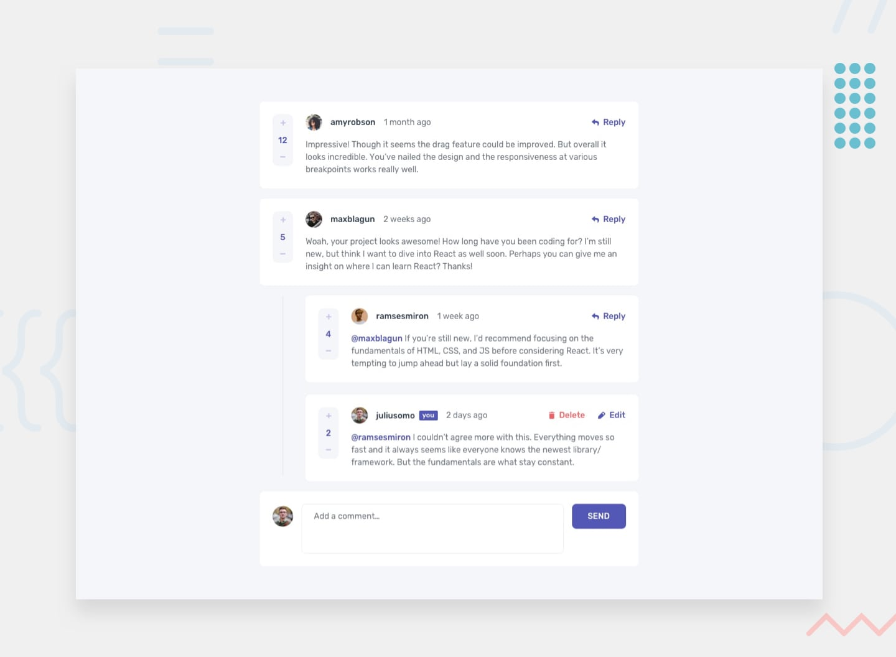

# Interactive Comments Section

A responsive, interactive comments application built with **Next.js, React, and TypeScript** as part of a Frontend Mentor challenge.

## Preview

## Features

- **Add comments** — Write and submit new comments.
- **Reply to comments** — Open and close reply forms with a toggle.
- **Edit comments** — Update existing comments.
- **Delete comments** — Confirm before deleting comments or replies.
- **Voting system** — Increase or decrease comment scores.
- **Responsive layout** — Adapted for mobile and desktop screens.
- **Component-based architecture** — Reusable React components with TypeScript.

## Tech Stack

- [Next.js](https://nextjs.org/)
- [React](https://react.dev/)
- [TypeScript](https://www.typescriptlang.org/)
- [Tailwind CSS](https://tailwindcss.com/)
- [Jest](https://jestjs.io/)
- [React Testing Library](https://testing-library.com/docs/react-testing-library/intro/)

## Getting Started

### Prerequisites

- Node.js
- npm

## What I Learned

- Managing component state and handling user interactions in React.
- Using TypeScript to improve type safety.
- Building reusable, maintainable UI components.
- Implementing comment CRUD operations.
- Testing React components with Jest and React Testing Library.

## Challenge

Built as part of the [Frontend Mentor – Interactive Comments Section](https://www.frontendmentor.io/learning-paths/introduction-to-front-end-testing-kacF_IJQO5/challenge/66a105f34833d72d4198a569/submit) challenge.

## License

This project was built for learning and portfolio purposes.
